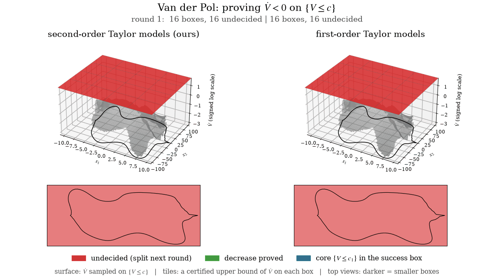

# fast-taylor-verifier

[](https://pypi.org/project/fast-taylor-verifier/)
[](https://pypi.org/project/fast-taylor-verifier/)

**Fast GPU-parallel Taylor-model bounds for smooth functions and neural networks.**

`fast-taylor-verifier` computes lower and upper bounds of a function over an entire input region, including functions
involving supported smooth neural networks. Unlike testing a function at sampled points, these bounds apply throughout
the region.

The package uses first-, second-, or third-order Taylor models to bound functions written with supported PyTorch
operations. It is designed for problems with a small number of input dimensions where many boxes must be evaluated.

Typical applications include:

- **Neural-network verification:** Bound the outputs and derivatives of supported smooth networks and check inequalities
  involving them.
- **Control and robotics:** Verify Lyapunov and barrier-function conditions, including Lie-derivative inequalities used
  in stability and safety analysis.
- **Global optimization:** Bound function minima over a region using branch-and-bound.
- **Numerical analysis:** Bound Jacobians and other derivatives of nonlinear functions.

To verify an inequality, the package divides the input region into boxes and computes bounds on each box. Boxes where
the inequality holds are discarded; the remaining boxes are subdivided and checked again.



*A proof that a neural Lyapunov function decreases (dV/dt < 0) on a region, as it runs. Green boxes are proved and red ones are split again; darker boxes are smaller. With second-order Taylor models (left) the proof needs 7.6k boxes, with first-order ones (right) 60k. At the end, the colour shows how often each box was split. From the [paper repository](https://github.com/YasinSonmez/certified-roa-fvi).*

The implementation runs with PyTorch on CPU or GPU. For higher performance, it also generates specialized CUDA kernels
that evaluate large numbers of boxes in parallel. On a two-dimensional neural Lyapunov verification benchmark, the CUDA
implementation was approximately 600× faster than CROWN on the same GPU.

> **Paper.** This package was developed for *Learning Controllers with Certified Regions of Attraction via Fitted Value
> Iteration and Second-Order Taylor Bounds*. The code to reproduce the paper is in
> [YasinSonmez/certified-roa-fvi](https://github.com/YasinSonmez/certified-roa-fvi).

## Contents

- [Installation](#installation)
- [Quickstart: prove an inequality](#quickstart-prove-an-inequality)
- [Computing bounds directly](#computing-bounds-directly)
- [Bound a neural network](#bound-a-neural-network)
- [How it works](#how-it-works)
- [More examples](#more-examples)
- [Performance](#performance)
- [Supported operations](#supported-operations)
- [Proving a property: `branch_and_bound`](#proving-a-property-branch_and_bound)
- [CUDA](#cuda)
- [Neural networks and derivatives](#neural-networks-and-derivatives)
- [Limitations](#limitations)
- [API reference](#api-reference)
- [Running the tests](#running-the-tests)
- [License](#license)

## Installation

```bash
pip install fast-taylor-verifier
```

| Requirement | Needed for |
|---|---|
| Python ≥ 3.10, PyTorch | everything; the PyTorch code runs on CPU or GPU |
| an NVIDIA GPU, the CUDA toolkit (`nvcc`) matching your PyTorch build, a C++ compiler, `ninja` | the CUDA kernels in `fast_taylor_verifier.cuda` |

The optional CUDA kernels are compiled on first use and cached for later runs (see [CUDA](#cuda)).

## Quickstart: prove an inequality

Prove that `x² + y² - 0.5xy > 0.37` for all `(x, y)` in `[0.5, 1]²`. `check` receives a batch of boxes, given by
their lower corners `L` and upper corners `U`, and returns the boxes where the lower bound is not yet above 0.37.
`branch_and_bound` splits those and calls `check` again:

```python
import torch
from fast_taylor_verifier import TaylorModel, branch_and_bound, evaluate

def f(p):                                            # p = (x, y), one point
    x, y = p
    return x ** 2 + y ** 2 - 0.5 * x * y

def check(L, U):
    m = evaluate(f, TaylorModel.box((L + U) / 2, (U - L) / 2))   # f on every box of the batch
    lo, hi = m.bounds()
    not_proved = lo[:, 0] <= 0.37
    return not_proved, m.scores()[not_proved]        # scores: which side of each box to split

r = branch_and_bound(torch.full((1, 2), 0.5), torch.ones(1, 2), check, batch=4096, h_min=1e-4)
print("proved" if r["failed"] == r["queued"] == 0 else "not proved")
```

## Computing bounds directly

You write `f` for a single point `x`, with `x[i]` its `i`-th input, using PyTorch functions. The same `f` runs on an
ordinary tensor such as `torch.tensor([0.5, 1.0])`. To bound it, create a batch of `B` boxes with `TaylorModel.box`,
from their centres and half-widths (two `(B, n)` tensors), and call `evaluate`, which runs `f` on all boxes at once:

```python
import torch
from fast_taylor_verifier import TaylorModel, evaluate

def f(x):                                            # x = (x[0], x[1]), one point
    return torch.sin(x[0]) * x[1] + torch.exp(-x[1] ** 2)

centres = torch.tensor([[0.0, 0.0], [0.5, 1.0], [1.0, -1.0]])
boxes = TaylorModel.box(centres, torch.full((3, 2), 0.1))    # 3 boxes, each of half-width 0.1 in both directions
lo, hi = evaluate(f, boxes).bounds()                 # (3, 1) each
```

A function with several outputs returns a tuple, `return (y0, y1)`; the bounds then have one column per output.

For each box `b`, `lo[b] ≤ f(y) ≤ hi[b]` for every point `y` in the box:

```
box 1:  0.9799 ≤ f ≤ 1.0101
box 2:  0.7246 ≤ f ≤ 0.9726
box 3: -0.6849 ≤ f ≤ -0.2465
```

## Bound a neural network

The package also works with supported smooth neural networks. This example computes output bounds for a tanh multilayer
perceptron on a two-dimensional input box:

```python
import torch
from torch import nn
from types import SimpleNamespace
from fast_taylor_verifier import TaylorModel, network

torch.manual_seed(0)
net = SimpleNamespace(s=nn.Sequential(
    nn.Linear(2, 16),
    nn.Tanh(),
    nn.Linear(16, 1),
))

centres = torch.tensor([[0.0, 0.0]])
half_widths = torch.tensor([[0.1, 0.1]])
boxes = TaylorModel.box(centres, half_widths)

with torch.no_grad():
    output, along = network(net, boxes)
    lo, hi = output.bounds()
print(lo.item(), hi.item())
```

`network` expects `net.s` to be an `nn.Sequential` of `nn.Linear` layers with `nn.Tanh` activations and one output. The
returned `along(v)` also bounds the directional derivative of the network along a vector field `v`, which is useful for
Lyapunov and other derivative inequalities. See [Neural networks and derivatives](#neural-networks-and-derivatives).

## How it works

Take a box with centre `x0` and half-widths `h`, and write a point in it as `x = x0 + d` with `|d| ≤ h`. A **Taylor
model** of a quantity `u(x)` on the box is a polynomial in `d` plus an error interval `[-r, r]`:

```
u(x0 + d)  ∈  c + Lᵀd + dᵀQd + T[d, d, d] + [-r, r]     for every |d| ≤ h
```

The order of the model is the degree of the polynomial: 1, 2 (with `Q`) or 3 (with `T`).

The computation starts from the input itself, `x = x0 + d`, which is exact (`r = 0`), and follows the operations in
`f`:

- **Sums** add the polynomials and the errors.
- **Products** multiply the polynomials. Terms of degree above the order are bounded on the box and added to `r`.
- **Functions** such as `sin(u)` are replaced by their Taylor polynomial around the centre value of `u`. The
  truncation error is bounded with the next derivative of `sin` over the range of `u`, and added to `r`.

At the end, the bounds are the range of the polynomial on the box plus `[-r, r]`.

The reason to keep a polynomial is that it remembers how each quantity depends on `x`. Interval arithmetic, the
simplest alternative, keeps only a range per quantity: for `x` in `[0, 1]` it computes `x - x` as
`[0, 1] - [0, 1] = [-1, 1]`, whereas a Taylor model gives exactly `0`. As a result, the bounds of a Taylor model get
closer to the true range as boxes get smaller, and those of interval arithmetic often do not. For `f` above, on boxes
centred at `(0.7, 0.3)`, the width of the bounds exceeds the width of the true range by:

| Half-width of the box | Interval arithmetic | Order 1 | Order 2 | Order 3 |
|---|---|---|---|---|
| 0.4   | 160 % | 150 % | 82 % | 80 % |
| 0.1   | 330 % | 62 %  | 28 % | 27 % |
| 0.025 | 340 % | 15 %  | 6 %  | 6 %  |

Tighter bounds mean that fewer boxes need to be split to prove a property.

## More examples

The timings are on one NVIDIA RTX 5090.

### Bound the global minimum of a function

Here `check` remembers the smallest value of `f` found so far at a box centre. A box whose lower bound is above that
value (minus a tolerance of `1e-4`) cannot contain a smaller value, so it is discarded. When every box is discarded,
the global minimum is known to within the tolerance:

```python
import torch
from fast_taylor_verifier import TaylorModel, branch_and_bound, evaluate

def camel(x):                                        # the six-hump camel function
    a, b = x
    return (4 - 2.1 * a ** 2 + a ** 4 / 3) * a ** 2 + a * b + (4 * b ** 2 - 4) * b ** 2

best = [float("inf")]                                # smallest value found so far

def check(L, U):
    m = evaluate(camel, TaylorModel.box((L + U) / 2, (U - L) / 2))
    best[0] = min(best[0], m.c.min().item())         # m.c: the values at the box centres
    may_be_lower = m.bounds()[0][:, 0] < best[0] - 1e-4
    return may_be_lower, m.scores()[may_be_lower]

r = branch_and_bound(torch.tensor([[-2.0, -1.0]]), torch.tensor([[2.0, 1.0]]), check, batch=4096, h_min=1e-6)
print(f"global minimum in [{best[0] - 1e-4:.5f}, {best[0]:.5f}] after {r['boxes']} boxes")
# global minimum in [-1.03169, -1.03159] after 203 boxes
```

### Verify a neural certificate for a controlled system

Consider a system `ẋ = f(x, π(x))` with a neural-network controller `π`, and a neural network `V(x)` meant to prove
that the system converges (a Lyapunov function) or stays safe (a barrier function). The proof requires that `V`
decreases along the system's trajectories, `∇V(x) · f(x, π(x)) < 0`, at every point of a region. `network(net, x)`
returns the model of `V` on each box and a function `along` that bounds the derivative of `V` along any vector field:

```python
s, along = network(net, x)                           # s: V on the boxes; along(v): ∇V · v
lie_lo, lie_hi = along(evaluate(closed_loop, x)).bounds()   # closed_loop(p): ẋ at one point p
not_proved = lie_hi[:, 0] >= 0
```

Times to prove the region of attraction of a
neural controller, from our paper:

| System | States | Boxes | Time |
|---|---|---|---|
| Van der Pol oscillator | 2 | 12 thousand | 15 ms |
| Inverted pendulum | 2 | 7.5 million | 0.39 s |
| Cart-pole | 4 | 16 million | 0.33 s |
| Planar quadrotor | 6 | 1.1 billion | 63 s |

On the neural barrier-function benchmarks of Vertovec et al. (L4DC 2026), it proves the same five certificates
2.6 to 81 times faster than their method.

### Bound a Jacobian

`jacobian(f, x)` bounds every entry of the Jacobian `∂f/∂x` on each box. The largest absolute value over all boxes
bounds each partial derivative over the whole region, which gives a Lipschitz constant:

```python
from fast_taylor_verifier import jacobian

lo, hi = jacobian(f, TaylorModel.box(centres, half_widths))   # each (B, m, n)
max_abs = torch.maximum(lo.abs(), hi.abs()).amax(0)           # (m, n): bound of |∂f_i/∂x_j| on all boxes
```

## Performance

The same region-of-attraction proof (Van der Pol oscillator, a neural Lyapunov function), with the bounds computed
three ways:

| Bounds computed by | Boxes | Time |
|---|---|---|
| CROWN ([auto_LiRPA](https://github.com/Verified-Intelligence/auto_LiRPA)) | 33 thousand | 8.3 s |
| `TaylorModel` in PyTorch, order 2 | 16 thousand | 0.47 s |
| `cuda`, order 2 | 16 thousand | 14 ms |

CROWN bounds general neural networks with linear functions. For this problem, a smooth function of two inputs, the
order-2 Taylor models needed half as many boxes, and the CUDA kernel was about 600 times faster than CROWN on the same
GPU.

## Supported operations

In a function `f` passed to `evaluate`, `jacobian` or `cuda.compile`:

| Operation | How to write it |
|---|---|
| inputs | `x[i]`, or `a, b = x` |
| outputs | return one value, or a tuple of values |
| arithmetic | `a + b`, `a - b`, `a * b`, `a / b`, `-a`, with numbers or other values |
| integer powers | `a ** k` for `k = 1, 2, 3, ...` |
| functions | `torch.sin`, `torch.cos`, `torch.tanh`, `torch.exp`, `torch.log` (or `a.sin()`, ...), `a.reciprocal()` |

`f` may not branch on values (`if x[0] > 0:`), because on a box `x[0]` is a range, not a number.

On boxes where the argument of `log` or `reciprocal` may be zero or negative, the bounds are infinite.

<details>
<summary><b>Batched code</b></summary>

A `TaylorModel` holding `B` boxes and `k` outputs also behaves like a `(B, k)` tensor, so code written for batches of
points runs on it directly: `f(TaylorModel.box(centres, half_widths))`. This is how `network` works, and it supports a
few more operations: `x[:, i:j]` (slices only, so shapes stay `(B, 1)`), `torch.cat([...], 1)`,
`a.sum(1, keepdim=True)`, `a.linear(W, b)` (`a Wᵀ + b`) and `a.sech2()`.

</details>

The model `m` returned by `evaluate` gives:

| Attribute | Shape | Contents |
|---|---|---|
| `m.bounds()` | `(B, k)`, `(B, k)` | lower and upper bounds on each box |
| `m.c` | `(B, k)` | the value at each box's centre |
| `m.width()` | `(B, k)` | how far the value can move from the centre value within the box |
| `m.scores()` | `(B, n)` | how much each input direction contributes to the variation of the first output on the box; `branch_and_bound` splits the box along the largest |

## Proving a property: `branch_and_bound`

```python
r = branch_and_bound(L, U, check, batch, h_min)
```

`L` and `U` are `(B, n)` tensors with the lower and upper corners of the starting boxes. You write `check(L, U)`: it
receives a batch of boxes and returns

1. a boolean tensor of shape `(B,)` that is `True` for the boxes that are **not yet proved**, and
2. split scores for those boxes, of shape `(number not proved, n)`, or `None` to split each box along its widest side.

`branch_and_bound` keeps a stack of boxes, passes up to `batch` boxes at a time to `check`, and splits every box that
is not proved into two halves along the side with the largest score (sides shorter than `2·h_min` are not split). A
box that is not proved when its largest half-width is at most `h_min` is not split further and is counted as
**failed**. The result is a dictionary:

| Key | Contents |
|---|---|
| `boxes` | number of boxes checked |
| `failed` | number of failed boxes |
| `queued` | number of boxes still waiting when the search stopped early (deadline, `max_failed` or `stop`) |
| `batch` | the batch size at the end; it is halved when CUDA runs out of memory |

The property is proved when `failed` and `queued` are both 0.

`check` is ordinary Python, so it can do more than compare a bound: keep state between calls (as in the
[global-minimum example](#bound-the-global-minimum-of-a-function)), record boxes where the property is violated, or
combine several bounds.

<details>
<summary><b>Optional arguments</b></summary>

| Argument | Meaning |
|---|---|
| `scale` | the unit of length in each direction, a number or an `(n,)` tensor; `h_min` and the comparison of side lengths use it |
| `aspect` | only split sides that are at least `aspect` times the longest side of the box (default 0: any side) |
| `tie_break` | add `tie_break` times the side length to the scores, so that equal scores favour the longer side |
| `deadline` | stop at this `time.time()` |
| `max_failed` | stop when more boxes than this have failed |
| `stop` | a function called before each batch; the search stops when it returns `True` |
| `log`, `log_every` | `log(boxes, queued)` is called at most every `log_every` seconds |

</details>

`split(L, U, score, ...)` performs one splitting step and can be used on its own.

## CUDA

Putting PyTorch tensors on a CUDA device makes `TaylorModel` use ordinary PyTorch GPU operations; it
does **not** compile the whole function into one kernel. `cuda.compile(f)` instead generates a specialized
CUDA kernel for supported operations, with one GPU thread per box. It runs `f` once to record its operations,
then generates and compiles the kernel:

```python
from fast_taylor_verifier import Settings, cuda

bound = cuda.compile(f)                              # f from "Computing bounds directly" above
centres = centres.to("cuda")
half_widths = torch.full_like(centres, 0.1)
box = cuda.Box(centres, half_widths, Settings(order=2))
lo, hi = bound(box)                                  # same bounds as evaluate(f, TaylorModel.box(...)).bounds()
```

`compile` supports the operations in the first table of [Supported operations](#supported-operations); for networks, use
`cuda.network`. The PyTorch and CUDA versions compute the same bounds up to float32 rounding, which the tests check.
Used inside `check`, to prove `f > 0.84` on `[0.5, 1]²` (the minimum there is 0.847):

```python
def check(L, U):
    lo, hi = bound(cuda.Box((L + U) / 2, (U - L) / 2, Settings(order=2)))
    return lo[:, 0] <= 0.84, None

r = branch_and_bound(torch.full((1, 2), 0.5, device="cuda"), torch.ones(1, 2, device="cuda"), check,
                     batch=4096, h_min=1e-4)
print("proved" if r["failed"] == r["queued"] == 0 else "not proved")
```

<details>
<summary><b>Compilation and caching</b></summary>

The CUDA code needs an NVIDIA GPU, the CUDA toolkit (`nvcc`) matching your PyTorch build, a C++ compiler and `ninja`.
The kernels are compiled the first time they are used, once for each function, number of inputs and settings, and
stored in `~/.cache/torch_extensions`. Compiling takes about a minute at order 2 and several minutes at order 3 with
many inputs. Later runs load the stored kernel.

</details>

<details>
<summary><b>Writing your own CUDA kernel</b></summary>

`cuda.compile` handles functions of the box. For anything else, such as a network inside the check or several bounds
per box, you can write a CUDA kernel that uses the same Taylor-model operations and compile it with `cuda.build`:

```python
ext = cuda.build("my_test", "void run(torch::Tensor x0, torch::Tensor h, torch::Tensor out);",
                 open("my_test.cu").read(), "run", cuda.flags(settings))
```

The source includes `taylor.cuh` for the Taylor-model operations and, to evaluate a tanh network, `network.cu`
(`launch_network`). For a box with `N` inputs, a model is stored as an array `float m[NC]` (`NC = M<N>::NC`) holding,
in order, `c`, the `N` entries of `L`, the entries `Q_ij` with `i ≤ j`, the entries `T_ijk` with `i ≤ j ≤ k` (order 3
only), and `r`. This is the packed format. The operations modify their arguments in place; `h` holds the box's
half-widths:

| Function | Effect |
|---|---|
| `copy<N>(a, b)`, `add<N>(a, b)`, `axpy<N>(a, s, b)` | `a = b`, `a += b`, `a += s·b` |
| `mul<N>(a, b, h)`, `scale<N>(a, s)`, `neg<N>(a)` | `b = a·b`, `a = s·a`, `a = -a` |
| `tanh_tm`, `sech2_tm`, `sin_tm`, `cos_tm`, `exp_tm`, `log_tm`, `recip_tm` `<N>(a, h)` | `a = g(a)` |
| `bounds<N>(a, h, lo, hi)`, `upper<N>(a, h)` | the bounds of `a` on the box |

A kernel for `f(x) = x0² + x1² − 0.5·x0·x1` on 2-D boxes:

```cuda
#include "taylor.cuh"
__global__ void quad_kernel(const float* x0, const float* hw, float* out, int B) {
    constexpr int N = 2, NC = M<N>::NC;
    int b = blockIdx.x * blockDim.x + threadIdx.x;
    if (b >= B) return;
    float h[N], x[N][NC];
    for (int i = 0; i < N; ++i) {                    // the box: x_i = x0_i + d_i
        h[i] = hw[b * N + i];
        for (int p = 0; p < NC; ++p) x[i][p] = 0.f;
        x[i][0] = x0[b * N + i]; x[i][1 + i] = 1.f;
    }
    float f[NC], t[NC];
    copy<N>(f, x[0]); mul<N>(x[0], f, h);                       // f = x0 x0
    copy<N>(t, x[1]); mul<N>(x[1], t, h); add<N>(f, t);         // f += x1 x1
    copy<N>(t, x[1]); mul<N>(x[0], t, h); axpy<N>(f, -0.5f, t); // f -= 0.5 x0 x1
    bounds<N>(f, h, out[2 * b], out[2 * b + 1]);
}
void run(torch::Tensor x0, torch::Tensor h, torch::Tensor out) {
    int B = x0.size(0);
    quad_kernel<<<(B + 127) / 128, 128>>>(x0.data_ptr<float>(), h.data_ptr<float>(), out.data_ptr<float>(), B);
    C10_CUDA_KERNEL_LAUNCH_CHECK();
}
```

To pass your own compile-time constants, add them to the flags: `cuda.flags(settings, NAME=value, ...)` adds
`-DNAME=value`.

</details>

## Neural networks and derivatives

### Network outputs and directional derivatives

`network(net, x)` evaluates a supported tanh network `net.s` over the boxes `x`. The network must be an `nn.Sequential`
of `nn.Linear` layers separated by `nn.Tanh`, with one output. It returns a model `s` of the network output and a
function `along(v)` modeling `∇s · v` for a Taylor-model vector field `v`:

```python
def field(p):                                        # a vector field, written for one point: returns n values
    return p[1], -torch.sin(p[0]) - 0.1 * p[1]

s, along = network(net, x)
s_lo, s_hi = s.bounds()
lie_lo, lie_hi = along(evaluate(field, x)).bounds()  # bounds of ∇s(x) · field(x) on each box
```

This is particularly useful for checking Lie-derivative inequalities in control, but `along` can be used with other
vector fields as well. For a standalone network example, see [Bound a neural network](#bound-a-neural-network).

### Jacobians

`jacobian(f, x)` returns `(lo, hi)`, each of shape `(B, m, n)`, for a function with `n` inputs and `m` outputs. It uses
forward-mode differentiation. For batched functions, the lower-level `Dual(v, t)` API carries a Taylor model of a value
and its derivative in direction `t`; `f(Dual(x, t)).t.bounds()` bounds that directional derivative.

## Limitations

- **Floating point.** The bounds are computed in float32, and rounding errors are not accounted for, in PyTorch or in
  CUDA. The bounds are exact for real-number arithmetic but can be off by rounding; a proof should leave a small
  relative margin.
- **Operations.** Only the operations listed above. `abs`, `max`, ReLU, `sqrt` and non-integer powers are not
  supported.
- **Box size.** Bounds are tight on small boxes. On large boxes, or where the function changes quickly, they are
  loose; `branch_and_bound` handles this by splitting.
- **Number of inputs.** A model has about `n²/2` coefficients at order 2 and `n³/6` at order 3, for `n` inputs. The
  CUDA kernels keep each box's models in registers or shared memory. We have used them with up to 6 inputs; more
  inputs work but run slower.
- **GPU.** The CUDA code needs an NVIDIA GPU and `nvcc`. The PyTorch code runs wherever PyTorch runs.

## API reference

<details>
<summary><b>Settings</b></summary>

`TaylorModel.box` and `cuda.Box` take a `Settings`. Every model computed from a box uses the settings of that box, and
each compiled CUDA kernel is specific to one `Settings`.

| Field | Default | Meaning |
|---|---|---|
| `order` | `2` | degree of the polynomial: 1, 2 or 3. A higher order gives tighter bounds on larger boxes, at a higher cost per box |
| `cheb` | `False` | for functions such as `sin`, also compute a polynomial that interpolates the function at Chebyshev points, and keep whichever gives the smaller error |
| `cheb_min_width` | `1e-3` | use the Chebyshev polynomial only when the argument's range is wider than `cheb_min_width × (1 + \|midpoint\|)` |

```python
x = TaylorModel.box(centres, half_widths, Settings(order=3, cheb=True))
```

</details>

<details>
<summary><b>Functions and classes</b></summary>

| Name | Description |
|---|---|
| `TaylorModel.box(centres, half_widths, settings=Settings())` | `B` boxes as models, from two `(B, n)` tensors |
| `Settings(order=2, cheb=False, cheb_min_width=1e-3)` | how the models are computed |
| `evaluate(f, x)` | the model of `f` (written for one point) on the boxes `x`: `.bounds()`, `.c`, `.scores()` |
| `jacobian(f, x)` | bounds of the Jacobian of `f`: `(lo, hi)`, each `(B, m, n)` |
| `Dual(v, t)` | a model and its derivative in one direction (forward mode) |
| `network(net, x)` | a tanh network on the boxes: `(s, along)` |
| `branch_and_bound(L, U, check, batch, h_min, ...)` | prove a property by splitting boxes |
| `split(L, U, score, ...)` | split boxes into halves along their highest-scoring side |
| `cuda.Box(centres, half_widths, settings)` | boxes for the CUDA functions |
| `cuda.compile(f)` | `f` (written for one point) as a CUDA kernel: `bound(box)` returns `(lo, hi)` |
| `cuda.network(net, box, tangents)` | a tanh network and its derivatives in the given directions |
| `cuda.dynamics(sys, box)` | packed models of the terms `a` and `b_j` of a control-affine system |
| `cuda.build(prefix, signature, source, function, flags)` | compile your own kernel that uses `taylor.cuh` |
| `cuda.flags(settings, **defines)`, `cuda.num_coeffs(n, order)`, `cuda.mlp_weights(net)` | helpers for your own kernels |

</details>

## Running the tests

The tests need a CUDA GPU (the first run compiles the kernels, which takes several minutes):

```bash
pip install -e .
python tests/test_fast_taylor_verifier.py          # or: pytest tests
```

## License

MIT; see [LICENSE](https://github.com/YasinSonmez/fast-taylor-verifier/blob/main/LICENSE).
